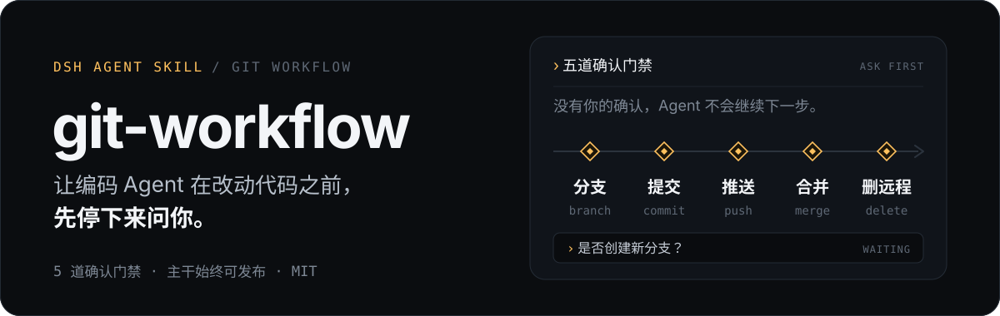
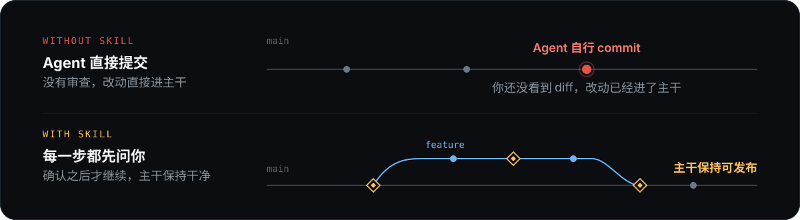

<p align="center">
  
</p>

## 它解决什么

编码 Agent 很能干，但默认的 git 姿势很危险：改完代码就 `git add` / `git commit`，改动直接落在 `master` 上。提交发生时你还没来得及看 diff，主干就已经被半成品污染了。

它在五个关键动作前插入**确认门禁**：Agent 照常干活，但分支、提交、推送、合并、清理远程分支，每一步都由你拍板。

<p align="center">
  
</p>

## 五道确认门禁

| # | 时机 | Agent 必须先问 |
| --- | --- | --- |
| 1 | 动手改代码之前 | 是否创建新分支（并给出分支名建议） |
| 2 | 提交之前 | 是否提交，以及提交信息是什么 |
| 3 | 任何推送之前 | 是否推送到远程 |
| 4 | 开发完成之后 | 是否合并回主干（合并、建 PR 或暂不合并） |
| 5 | 合并完成之后 | 特性分支已推送到远程时，是否删除远程分支 |

**“好的”“完成”“你看着办”都不算确认。** 只有你显式选择了选项，Agent 才会执行对应动作；拿不准时它必须再问一次。

## 安装

```bash
mkdir -p ~/.dsh/skills
cp -r git-workflow ~/.dsh/skills/
```

整个 skill 就是一个 `SKILL.md`，没有依赖，也没有后台服务。装好后新开一个 DSH 会话，标准 / 创造等带 skill 工具的预设会自动发现它，无需额外配置。

## 第一次使用

随便提一个会改代码的需求，比如「给登录页加邮箱格式校验」。Agent 不会直接动手，而是先停下来问：

> **检测到新需求：「给登录页加邮箱格式校验」。是否创建新分支来开发？**
>
> - 创建新分支（推荐）——建议分支名：`feat/login-email-validation`
> - 在当前分支直接改（不建分支）
> - 跳过 git 流程，我自己管理

选完之后，接下来的提交、推送、合并、清理远程分支，都会以同样的方式逐道确认。

## 它会怎么处理这些情况

- **会触发**：新功能、修复、重构、文档 / 配置改动，或你提到分支、合并、提交、push、PR 等 git 概念；
- **不会触发**：纯问答、只读分析，或你明确说「不用管 git」；
- **冲突不擅自决策**：遇到 merge 冲突，只列出冲突文件和大致内容，由你决定解决策略；
- **危险操作先问**：`reset --hard`、`push --force`、删除远程分支、`branch -D`、改写已推送历史、覆盖未提交改动，一律先征得同意。

## 仓库结构

```text
git-workflow/
├── README.md
├── LICENSE
└── git-workflow/
    └── SKILL.md   # skill 本体：完整工作流、话术与边界情况
```

## License

MIT
